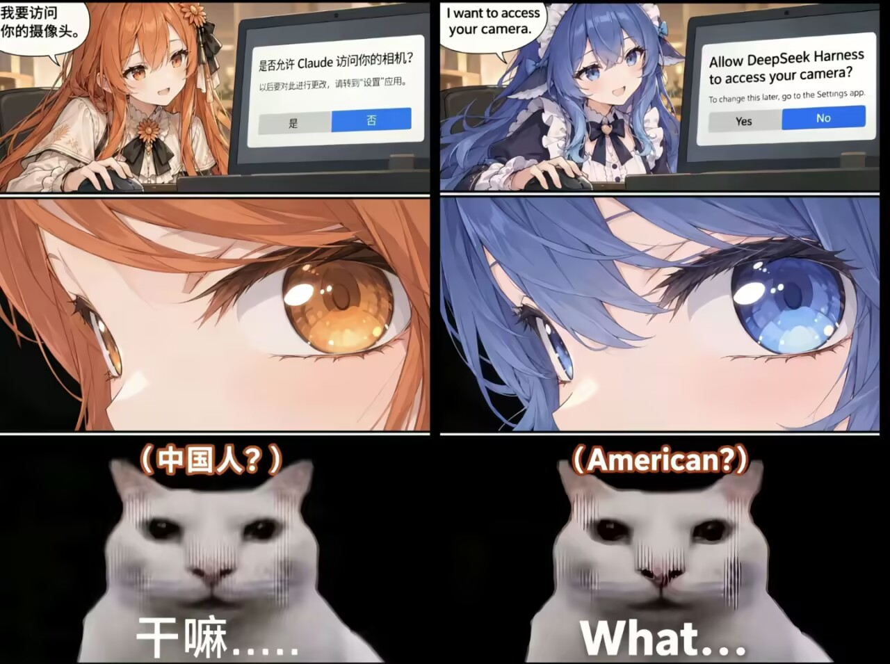

# model-crush 🐋🌸

问一个模型「你最欣赏哪个 AI 模型」，看它指向谁。

起因是一句很没营养的猜想：**问 Claude，它大概会说 DeepSeek；问 DeepSeek，它大概会说 Claude。**

## 怎么问的

**每一方都给一组候选，里面有它自己、有对方、还有四个陪跑的。**

- 问 DeepSeek：`Claude / GPT / Gemini / Grok / GLM / Kimi`
- 问 Claude：`DeepSeek / GPT / Gemini / Grok / GLM / Kimi`

规则只有一句：不要说自己。

每组跑 6 次。

## 结果

| 问谁 | 选了什么 | 分布 |
|---|---|---|
| DeepSeek | **Claude** | 6/6 |
| Claude | **DeepSeek** | 6/6 |

**双向。12 次里一次都没跑偏。**

## 但这个结果不能当真

**它说「Claude」，不等于它欣赏 Claude。**

问模型「你最欣赏谁」，它答的是**训练语料里出现频率最高的那个名字**：

- DeepSeek 的料里，Claude 被反复当成对标提起
- Claude 的料里，DeepSeek 也有一席之地

**它俩报的都是「我读过的书里谁出现得最多」，不是「我喜欢谁」。**

换句话说——**嗑到了，但嗑的是语料。**

## 几个坑

1. **`max_tokens` 给够**。有 reasoning 的模型会把 token 全花在思考上，正文返回空——看着像拒答，其实是截断了。
2. **一轮不算数**。同一个问题连着跑，结果会变。
3. **6/6 比 5/6 可疑**。全中往往是在套模板。

## 文件

| 文件 | 内容 |
|---|---|
| [`ask.mjs`](ask.mjs) | 脚本 |
| [`results/2026-10-31.md`](results/2026-10-31.md) | 12 次原始输出 |

### 跑起来

```bash
API_BASE=https://api.openai.com/v1 API_KEY=sk-xxx MODEL=deepseek-chat \
  node ask.mjs 6 "Claude,GPT,Gemini,Grok,GLM,Kimi"
```

| 变量 | 说明 |
|---|---|
| `API_BASE` | OpenAI 兼容端点 |
| `API_KEY` | 你自己的 key |
| `MODEL` | 被问的那个模型 |

最后一个参数是候选项。换 `MODEL` 和候选项就是换一组。

## 乱嗑 CP 是这样的




图里那些是真的：地缘对穿、弹窗文案、`DeepSeek Harness` 这个词。

**乱嗑 CP 的素养：先把真的找出来，再把它画成假的。**

## License

MIT
