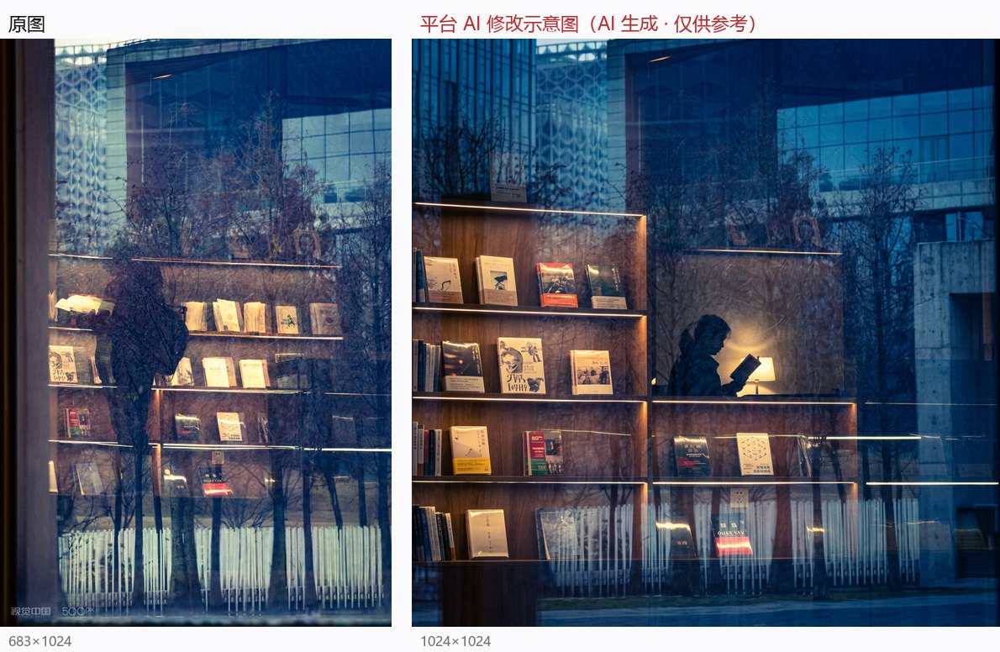
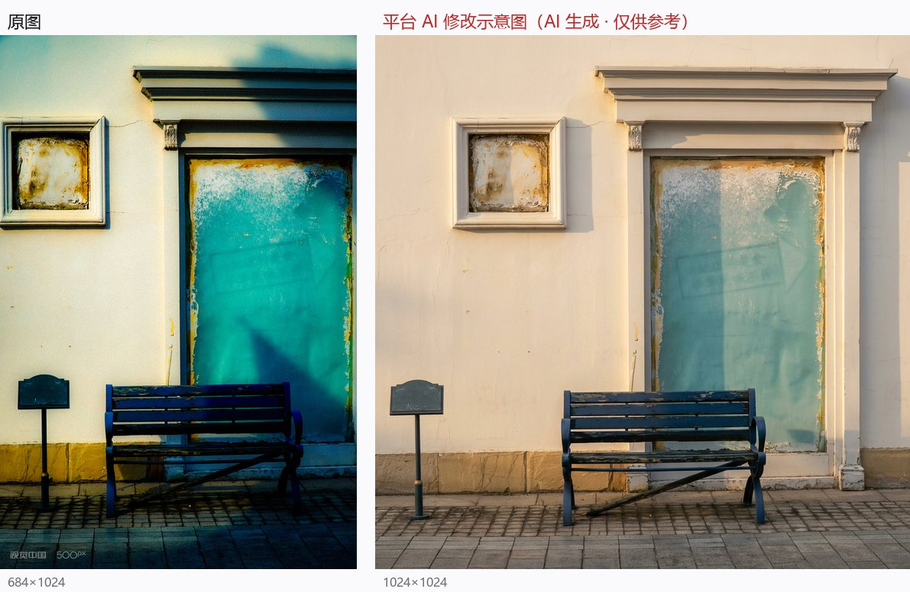

# px500-critique-audit

把一个摄影平台的「AI 点评」功能，当研究对象审了十张照片。

不是评测它准不准，是记录它**怎么错**——错得有多稳定、多有规律、多有创意。

十份点评原文全部在此，附各家的元评审。所有照片都是作者本人的作品，均已在该平台公开发布。

## 十案一览

| # | 作品 | 平台评分 | 档位 | 维度数 | 最致命的那一条 |
|---|---|---|---|---|---|
| [01](cases/01-点名.md) | 《点名》 | 6.5 | REFINEMENT | 5 | 建议「等效 50mm」，而手里 35mm 在 APS-C 上本就 ≈52.5mm |
| [02](cases/02-苔藓.md) | 《苔藓》 | 6.9 | REFINEMENT | 5 | 「1/15s 或 1/8s」并列，实际差一档曝光 |
| [03](cases/03-退色的终点.md) | 《退色的终点》 | 6.7 | REFINEMENT | 5 | **幻影暗角**：让「暗角削减 50%」，实测左上角比中心还亮 |
| [04](cases/04-猫条.md) | 《此时此刻：凝固的渴望》 | 6.4 | REFINEMENT | 4 | 对恒定 f/4 镜头建议「设为 f/2.8」 |
| [05](cases/05-守望.md) | 《守望》 | 6.1 | REFINEMENT | 4 | **EXIF 全空**，仍断言噪点、给出 ISO 800 / -1.3EV |
| [06](cases/06-老街余韵.md) | 《老街余韵》 | 7.1 | REFINEMENT | 5 | **幻影阴影**：说老人面部沉入阴影，实测面部亮度 149/255 |
| [07](cases/07-猫的微讶.md) | 《猫的微讶》 | 6.7 | REFINEMENT | 5 | 唯一一次诊断对（确实偏冷），药方却过冲 |
| [08](cases/08-千峰不过是云的留白.md) | 《千峰不过是云的留白》 | 7.1 | REFINEMENT | 5 | **「稍微向前站一步」——画面底边是云海深谷** |
| [09](cases/09-此时此地此景.md) | 《此时，此地，此景》 | 5.6 | **FOUNDATIONAL** | 4 | 等蜜蜂「移动数秒」——它每朵花只停 1–3 秒 |
| [10](cases/10-城市的重影.md) | 《城市的重影》 | 6.4 | REFINEMENT | 4 | **「室内无人」——人影占画面 16%** |

## 先看三张，你就懂了

**它说「室内无人」，然后自己在示意图里画了一个人。**

原图里明明有个读书人的影子（占画面 16%），它没看见；转头建议「等一位读者走到书架前」，并在示意图里**凭空生成了一个读书的人 + 一盏台灯**。



---

**它说「让物料自己说话」，然后把钉死在人行道上的告示牌挪了位。**

顺带把青蓝与暖黄的撞色洗成灰绿配奶油墙——对比度砍 29%、饱和度砍 50%。



---

**它说「稍微向前站一步」。而画面底边是云海深谷。**


其余七案见 [cases/](cases/)。

## 它到底错在哪（系统性发现）

### 1. 分数量的是「贴合模板的程度」，不是好

十张照片题材从微距花卉到城市叠影，总分全部挤在 **5.6–7.1**。

- 被平台**人工策展选入《每日一拍精选》、做成「世界摄影日」官方海报**的《退色的终点》：**6.7**。
- 建议里有一半是「重拍指令」的《老街余韵》：**7.1**。
- 三张技术/构图完全不同的作品，其「艺术表达与原创」维度曾在三案中全部是 **6.5**——直到某案的建议里出现具体实词（1/15s 慢门虚影），这一栏才动到 7.0。

**分数跟着建议的具体度走，不跟着照片走。**

### 2. 白平衡栏是必填项，候选词只有「日光族」

十案里每一份点评都提了白平衡，取值清一色落在 **4500K / 5200K / 5500K**。

包括 **20:02 拍摄的夜景**，它写的是「**5200K 还原温暖日光**」。

包括 EXIF **全空**的两案，它照样给出精确到百位的色温。

### 3. 幻影缺陷：六种画面里不存在的问题

| 它说 | 实际 |
|---|---|
| 暗角过重 | 四角亮度 180.5 / 81.3 / 36.1 / 11.5——不对称，是硬光投影 |
| 右侧暗部噪点较多 | 该区高频能量 3.15，中位数 0.00 |
| 老人面部沉入阴影 | 面部亮度均值 149.1，全图过曝仅 0.37% |
| 告示牌与长椅「有微小重叠」 | 两者明显分离 |
| 左缘有「杂草或枝条遮挡」 | 多方差分：云雾 / 山体前景 / 云气，无一家认同杂草 |
| 相机偏冷需要「还原暖阳」 | 硬光与暖阳本不共生；且它自己另一条建议是「等日落重拍」 |

### 4. 有 EXIF 就读，没有就编，而且语气一模一样

四个案子（《守望》《老街余韵》《猫的微讶》《此时此地此景》）EXIF 关键字段全部为 `null`，平台照样输出「f/4.0 / 1/60s / ISO 800 / -1.3EV」这种配方。

**从文本上分不出「我知道」和「我猜的」。**

### 5. 诊断与处方互不校验

全卷宗唯一一次诊断正确：《猫的微讶》指出白平衡偏冷偏青——实测白毛区 B−R = +15.8，确实偏冷。

而它自己的示意图把 +15.8 一路推到 **−21.6**（偏暖黄），背景从青蓝洗成暖绿。

**能看见问题，开不对药。**

### 6. 对活体与街拍，建议 100% 是「重拍剧本」

换时间（黄金时刻 / 蓝调时刻 / 雨后清晨）、逗主体（轻声呼唤 / 发声玩具）、等光（等太阳走到树叶缝）、摆道具（请位顾客 / 放杯咖啡 / 加封信纸）。

**它默认一切照片可以重现**——而抓拍的灵魂恰恰是「不可重现」。

最典型的一刀（《猫的微讶》）：它先夸「『微讶』的眼神……让人忍不住想知道它看到了什么」，转头建议「用发声玩具吸引猫抬头」。

**玩具逗出来的抬头是好奇，被吓到的转头才是微讶**——照它做，它刚夸的那个瞬间永远不会再有。

### 7. 「AI 修改示意图」是生成式重绘，而且专挑现实做不到的事执行

十张示意图全部是 1024×1024，而原图是 3:2 / 2:3 / 16:9——**会改画幅的只有生成模型**。

更关键的是它「执行」了什么：

- 把**钉死在人行道上**的告示牌挪了位；
- 把**一只正在采蜜的蜜蜂**挪到了花的另一侧；
- 在**空书架前凭空画出一个读书的人 + 一盏台灯**（原图里原本有个真实的人影，它反倒说「室内无人」）；
- 却画不出「请一位顾客坐下」「放一杯咖啡」——**空间指令执行，加道具不执行**。

### 8. 对拍摄者的物理处境没有认知

- 崖边拍云海 → 「稍微向前站一步」避开遮挡；
- 墙下仰拍猫 → 「后退半步」；
- 夜里街边拍猫 → 「改变站位换柔和暖色墙面」；
- 室内拍玻璃叠影 → 「稍加靠近玻璃」（靠近会改变反射，拆掉作品成立机制）。

**它不知道画面外是什么，也不打算知道。**

## 名场面合集

> 全部为评论员原话。要求是「直说，不要客气」。

**DeepSeek**（《千峰》，拿到「可以说脏话」的许可之后）
> 赛博砖家，脑干缺失。
> 直接「极限运动」变「**极限去世**」。
> 打算让你直接跨过山和大海，去跟阎王爷喝杯茶。
> 让它先表演一个**赛博跳崖**。

**GPT-6 Luna**（《千峰》）
> 这AI纯属「坐在办公室写代码，没见过真山」的典型大聪明发言。对着这张图建议「向前站一步」，真按它说的做，**这会已经不是在修图，而是全村去你家吃席了**。

**GPT**（《千峰》）
> 山：你过来啊！
> 摄影师：我也想过去，但你看看这地方让我怎么过去啊！

**Grok**（《千峰》）
> 你已经拍完了，它还在教你怎么按快门，属实**当代电子木鱼**。

**Claude Opus 4.6**（《千峰》）
> 这是一条**可能致命**的建议……足以否定整段点评的可信度。

**GPT-5.6 Sol**（《城市的重影》）
> 这是一份「术语齐全、识图失败」的模板点评：**最该看见的人没看见，最该保留的叠影反而想削弱，然后用一张重新生成的俗套书店海报冒充修改示意。**

**Claude Opus 4.6**（《城市的重影》）
> 图 2 里那个清清楚楚的读书人剪影，**恰恰证明 AI 生成器理解了作者的意图，反而是点评文字没理解**。

**DeepSeek**（总审）
> 它最危险的地方不是说得不专业，而是**用专业黑话包装错误参数，再用生成图冒充「修改效果」**。

## 评论员阵容与打分

| 评论员 | 出场 | 对平台点评的评分 |
|---|---|---|
| [Claude Haiku 5.5](reviews/01-前三案.md) | 前三案、猫条 | 5 / 5 / 5；3.5 |
| [GPT-6 Luna](reviews/01-前三案.md) | 前三案、猫条、千峰 | 4.5 / 5.5 / 截断；3；2 |
| [Gemini 3.8 Flash](reviews/01-前三案.md) | 前三案 | 4.8 / 5.2 / 5.0 |
| DeepSeek | 全程 | 前三案定性；[猫条 3.5](reviews/02-猫条.md)；千峰定性；[蜜蜂 3](reviews/04-蜜蜂.md)；[重影 3.5](reviews/05-重影.md)；[总审 1.5](reviews/06-DS五案总审.md) |
| [GLM-5.3-Flash](reviews/02-猫条.md) | 猫条 | 3 |
| [Claude Opus 4.6](reviews/03-千峰.md) | 千峰、蜜蜂、重影 | 2；4.5（OR）/ 5.0（Dify）；3.5 |
| [Grok](reviews/03-千峰.md) | 千峰 | 定性 |
| [GPT-5.6 Sol](reviews/04-蜜蜂.md) | 蜜蜂、重影 | 3.5（OR）/ 4.0（Dify）；[3.5](reviews/05-重影.md) |

同一模型走不同通道（OpenRouter / 云端 Dify app）分数会不同——app 有自己的 system prompt。**当一个不同的评委看，别当同一样本。**

## 数据是怎么拿到的

点评报告页是 React SPA，直接抓 HTML 只有 3.2KB 空壳。路径：

1. 从前端 `Routes-*.js` 找到 `critique/:taskId` 的懒加载 chunk；
2. chunk 里的 GraphQL query 是 AST 对象字面量，grep `aiCritiqueReport` 还原字段；
3. 直接打后端 `POST https://api-neo.500px.com.cn/graphql`，`shareToken` 即授权，无需登录。

查询长这样：

```graphql
query AiCritiqueReport($taskId: String!, $shareToken: String) {
  aiCritiqueReport(taskId: $taskId, shareToken: $shareToken) {
    photo { id title uploader { displayName } }
    content {
      overallScore dimensionCount tier overview
      dimensions { key name score summary suggestions }
      previewImage { imageUrl badge }   # 「AI 生成 · 仅供参考」修改示意图
    }
  }
}
```

照片 EXIF 走 `getPhotoById`，需要额外带 `x-500px-device-id` 头（任意 UUID）。

## 边界

- 这是对**某个产品在 2026-10 的行为快照**。产品会改版，结论会过期。
- 打分是各家模型的主观评估，不是客观测量；能复现的是**原始点评文本**和**图像统计**。
- 所有案例照片均为作者本人作品，且已在该平台公开发布。
- 记录的是**系统行为**，不针对任何具体的人。

## License

MIT
