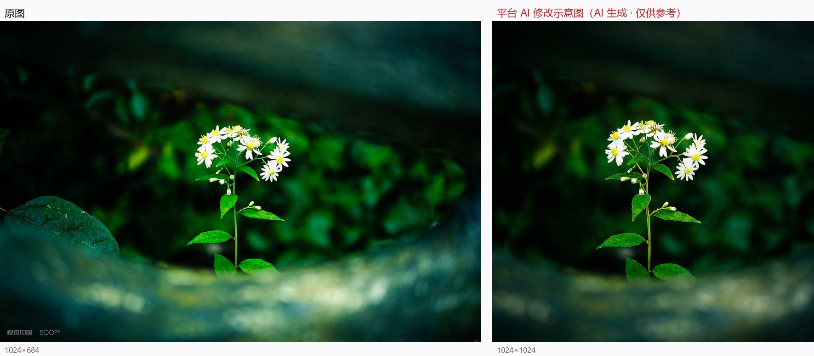

# 01 《点名》

> 平台评分：**6.5 / 10** · 档位 `REFINEMENT` · 5 个维度

**EXIF（实测）**：SONY ILCE-6400（APS-C）· TTArtisan 35mm F1.8 定焦 · f/1.8 · 1/250s · ISO 100

> 左：原图　右：平台生成的「AI 修改示意图」

## 平台原文

**总评**：你捕捉到了这株白色小野菊在暗沉背景中顽强挺立的生命力，配合「点名」这个标题，充满了诗意与拟人化的灵气。明暗对比很自然地把视线引向花朵，前景的暗部框架也营造出了独特的窥视感。目前最主要的提升空间在于构图的平衡感与焦平面精细度，如果能将视角稍微抬高、避开左下角略显突兀的大叶片，主体会呈现得更加舒展干净。

### 技术执行　6

在较暗的环境下，1/250s 的快门成功冻结了花朵，ISO 100 也保持了画面的干净纯粹。不过在 f/1.8 全开光圈下，景深极窄，导致只有部分花瓣落在焦平面内，边缘花朵略显软化。

- **建议**：建议将光圈收缩至 f/2.8 或 f/4，在自然光下保持 ISO 400、快门 1/160s，采用单点对焦（AF-S）精准锁定在最前方的黄色花芯上，并开启日光白平衡（5200K）以还原精准的白色花瓣。

### 视觉美学　6.5

中央居中的主花构图稳当，背景深绿色的自然暗角有效地突出了白色花朵。然而左下角占据较大面积的虚化叶片形成了较强的视觉干扰，打破了底部的视觉平衡。

- **建议**：调整拍摄机位，稍微向右上方移动镜头，利用微小的视角偏移避开左下角粗糙的叶片，让暗色前景形成一个完整的环形暗角框住主花。

### 主体·场景·环境　6.5

主体小野菊形态优美，在背景暗部幽光的衬托下显得清秀生动。场景的自然光感很好，但缺乏一点来自光线方向的层次感。

- **建议**：尝试在早晨或傍晚斜射光入林时拍摄，或者使用反光板/小手电从侧后方 45 度给花朵补一束微弱的轮廓光，让主体从背景中更好地分离出来。

### 叙事·氛围·情绪　7

「点名」这个命名赋予了作品灵魂，白花在众绿之中如举手回应般挺拔，画面氛围静谧而有温度。花朵的姿态与暗色背景形成了情感上的对话。

- **建议**：使用等效 50mm 或 85mm 焦段靠近拍摄，在维持微距感的同时保留背景的深沉色调，强化独秀一掷的情绪感。

### 艺术表达与原创　6.5

将拟人化的概念融入植物摄影，表现出了对日常微观自然敏锐的观察力。暗调背景与白花的对比展现了很好的美学直觉。

- **建议**：可以尝试更极致的极简主义构图，压暗背景两侧细节，让光线完全聚焦在花茎与花朵的线条美感上。

## 本案的问题

- 「用等效 50mm 或 85mm 焦段靠近拍摄」——35mm 在 APS-C 上本就 ≈52.5mm，等于建议换到你正站的位置
- 曝光配方经核算会**过曝约 1.4 档**，与它自己「还原精准的白」目标相反
- 同一片左下叶子：总评夸「暗部框架＝独特窥视感」，视觉维度又骂「视觉干扰」，艺术维度再让你删掉
- 「白平衡 5200K 还原精准白」——过曝是亮度、白平衡是色温，两轴无关
