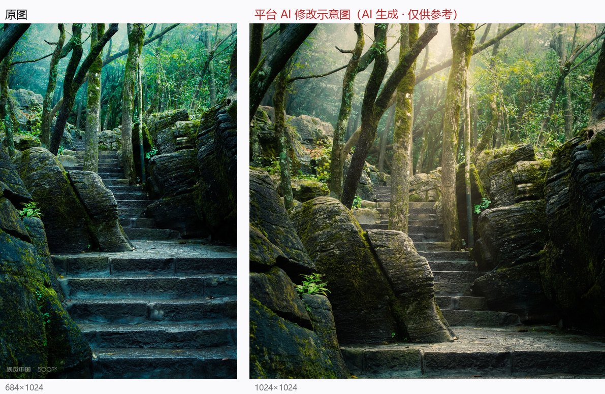

# 02 《苔藓》

> 平台评分：**6.9 / 10** · 档位 `REFINEMENT` · 5 个维度

**EXIF（实测）**：SONY ILCE-6400（APS-C）· TTArtisan 35mm F1.8 · f/8 · 1/50s · ISO 640

> 左：原图　右：平台生成的「AI 修改示意图」

## 平台原文

**总评**：你成功捕捉到了森林深处那种神秘而清凉幽郁的静谧感。古老的石阶梯在苔藓与巨石间延伸，画面的高饱和青绿色调和纵向延伸感都非常有感染力。美中不足的是前景石阶占比例略大且暗部细节稍有缺失，加上顶部的森林雾气缺乏明确的光线穿透，让画面略显沉闷。如果能稍微降低取景视角、保留更多自然光辉，作品会更有灵动感。

### 技术执行　6.5

在 f/8 的光圈下，整张照片从前到后都保持了相当扎实的清晰度，石阶与树干上的苔藓纹理都展现得很清楚。不过前景下方的阴影区略微偏暗，细节显得有些黏连；同时后期的色调倾向略重，导致色彩过渡稍显生硬。

- **建议**：现场拍摄配方：在森林阴影下拍摄时，建议保持 f/8 光圈以确保足够景深，快门可适当延长至 1/15s 或 1/8s（搭配三脚架），ISO 降至 100 以获得最佳动态范围；使用单点 AF 锁定在画面中景（约第三级台阶处），白平衡建议手动设为 Daylight（约 5200K）以还原自然暖绿，避免过度偏青。

### 视觉美学　7

石阶形成的竖向线条极具引导力，将人的视角自然地向森林深处带入。但是视角的选取略显平直，底部的石阶充斥了大量画面空间，占据了太多的视觉重心，削弱了顶部树冠与远方森林的呼吸感。

- **建议**：尝试采用低角度仰拍，或者将相机向上微抬，将画面底部切掉最前方的两级台阶，把更多空间留给上方蜿蜒伸展的树枝与薄雾。

### 主体·场景·环境　7.5

你挑选了一个非常迷人的拍摄地点，湿润的空气感和郁郁葱葱的树木环境极具感染力。然而，当前的平光天气缺少了一丝灵动，如果能捕捉到清晨第一缕穿透树冠的耶稣光（丁达尔效应），环境的质感将大幅提升。

- **建议**：建议选择在雨后初晴的清晨重访此地，利用晨雾与侧逆光的结合，捕捉光束穿透树冠洒在苔藓石阶上的瞬间。

### 叙事·氛围·情绪　7

照片传达出一种深邃、幽静且带有一丝神秘感的情绪，像是一条通往隐秘仙境的古老通道。可惜由于缺乏视觉终点（如在阶梯尽头隐藏的微光或微小元素），叙事感稍显停滞。

- **建议**：可以在构图时将石阶的尽头安排在三分法交汇点上，并等待光线在阶梯转折处形成亮区，引导观者在想象中踱步前行。

### 艺术表达与原创　6.5

作品展现了你对神秘森林题材的明确审美偏好，高饱和与电影感色调的尝试体现了你的创作意图。不过在风光摄影中，自然光影的微妙层次往往比后期色调渲染更有说服力。

- **建议**：试着减少后期的青色偏移，保留植物本身丰富的中黄、翠绿与深绿过渡，用光影反差而非单一色彩强化幽静感。

## 本案的问题

- 配方「1/15s 或 1/8s + ISO100」并列，但两者差一档曝光；照 1/15s 拍会欠曝约 1 档
- 「降低取景视角」与「向上微抬 / 低角度仰拍」自相矛盾
- 「Daylight 5200K 还原自然暖绿、避免偏青」——森林阴影下设 5200K 反而更冷
- 「等雨后初晴清晨拍耶稣光」——把天气运气包装成可执行建议
