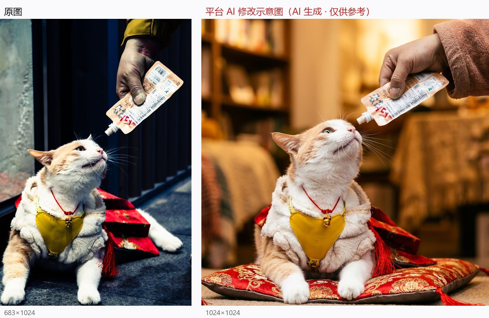

# 04 《此时此刻：凝固的渴望》

> 平台评分：**6.4 / 10** · 档位 `REFINEMENT` · 4 个维度

**EXIF（实测）**：SONY ILCE-6400 · E PZ 18-105mm F4 G OSS（恒定 f/4）· f/4 · 1/125s · ISO 3200 · 64mm · 20:02 夜

> 左：原图　右：平台生成的「AI 修改示意图」

## 平台原文

**总评**：你敏锐地捕捉到了猫咪仰头盼望零食的动人瞬间，猫咪微张的小嘴、胡须与眼神充满了生动的渴望，人手的加入也让画面具有温暖的互动感。不过，由于画面整体反差偏高、暗部沉重，导致猫咪面部细节有所缺失，且上方的手持零食包显得略微拥挤。如果我们能在光线处理与构图空间上做一点小调校，这一刻的温馨与张力会表现得更加完美。

### 技术执行　6

在 1/125 秒的快门下较好地凝固了猫咪的动态，白须清晰可见。但整体曝光反差过大，高光与暗部过于陡峭，造成猫咪背部及背景暗部细节有些沉闷，同时高感光度下带来了微小噪点。

- **建议**：建议曝光配方：光圈设定为 f/2.8 或 f/4 保持背景适度虚化，快门提升至 1/250s 以更稳妥地凝固动作；ISO 降至 800-1600 之间，配合 +0.3 EV 曝光补偿提亮暗部细节；对焦模式选择「AF-C 连续自动对焦」配合「实时人眼/动物眼部 AF」，将焦点精准锁定在猫咪靠近镜头的那只眼睛上；色温设为 5200K 还原温暖日光。

### 视觉美学　6.5

竖构图很好地呈现了从上至下的引导线，猫咪的白毛与红色垫子形成了明快的色彩对比。可惜的是上方手部与零食包切边较近，压迫感略强，画面上方缺少呼吸感。

- **建议**：适当后退半步或将焦距微调至 50mm 左右，在画面顶部留出约 15% 的视觉呼吸空间，完整保留手部姿势与零食包的全貌。
- **建议**：稍微压低机位，采用与猫咪眼睛平视的角度微仰拍，增强猫咪仰头期盼的视觉张力与主体存在感。

### 主体·场景·环境　6

主体猫咪与穿戴的胸背带、红色垫子十分吸睛，展示了接地生活场景。然而背景深沉冷硬的立柱与杂乱的地板线，对温馨的主体造成了一定干扰。

- **建议**：改变站位让背景换为柔和的暖色墙面或富有生活气息的自然环境，利用自然漫射光为场景增添生活温度。
- **建议**：整理干净猫咪身下的垫子，或者让垫子自然平铺，减少繁杂褶皱对视觉的干扰。

### 叙事·氛围·情绪　7

这张照片最动人的地方在于极其生动的瞬间与眼神，猫咪伸长脖子、嘴角微张的样子精准传达了「渴望」的情绪，极具感染力与耐看度。

- **建议**：抓住猫咪舌头刚刚伸出舔舐零食的那一极点瞬间按下快门，能将「渴望与满足」的情绪推向更高潮。

## 本案的问题

- 「光圈设定为 f/2.8 或 f/4」——这颗恒定 f/4 变焦**物理上开不到 f/2.8**
- 「色温 5200K 还原温暖日光」——拍摄时间 20:02，夜里没有日光
- 配方净变暗 1.7–2.7 档，却说是「提亮暗部」
- 「总评夸渴望 → 建议抓舌头舔舐」：渴望 ≠ 满足，与自己标题《凝固的渴望》打架
