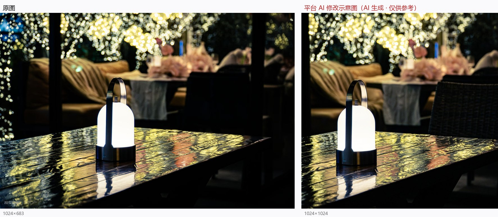

# 05 《守望》

> 平台评分：**6.1 / 10** · 档位 `REFINEMENT` · 4 个维度

**EXIF（实测）**：**全部字段为 null**（仅 lens: E PZ 18-105mm F4 G OSS）

> 左：原图　右：平台生成的「AI 修改示意图」

## 平台原文

**总评**：你捕捉到了一个非常有温度的瞬间，背景中密密匝匝的金色灯束化为了梦幻般的焦外光斑，桌面上的湿润质感与灯光倒影更是极具视觉张力。灯盏本身的造型很精致，但在高亮发光时丢失了细节，且位置略显呆板。如果我们能稍微调整曝光与构图，这张照片将具备极强的电影感与情绪感染力。

### 技术执行　5.5

背景的梦幻光斑与桌面倒影被清晰地记录了下来，整体对焦也比较准确。不过桌面提灯的发光罩部位过曝严重，导致白色灯罩失去了材质细节与层次；同时画面右侧暗部存在较多噪点。

- **建议**：建议采用光圈 f/4.0、快门 1/60s、ISO 800，并开启 -1.3 EV 的曝光补偿以压制灯罩过曝；使用单点对焦（Single-point AF）精确对焦在灯具的前端金属边框上，白平衡设为「日光/5500K」或手动设为 4500K 来维持夜色的深邃与温暖灯光的对比。

### 视觉美学　6.5

背景中密集的金色焦外虚化非常绚烂，湿润桌面反射的黄绿交错光影也非常出彩。可惜灯座被正正地安放在了视线中央偏下的位置，导致构图略显呆板，同时左下角的强光略微抢戏。

- **建议**：试着降低机位至接近桌面高度，并将主体灯具挪至画面左侧三分之一交叉点处，利用湿润桌面的金色倒影作为引导线延伸至右侧背景。

### 主体·场景·环境　6

夜幕下的户外餐桌与串灯营造出了很棒的都市温暖角落氛围，桌面上湿润的纹理增添了环境质感。遗憾的是主体灯具与背景沙发、餐桌的互动不足，未能很好地交代环境故事。

- **建议**：可以等待或邀请一位顾客坐在背景虚化的沙发区，或是将一杯泛着微光的温热咖啡放在灯具旁，让环境与主体建立起叙事联系。

### 叙事·氛围·情绪　6.5

标题《守望》赋予了照片很好的情绪基底，孤灯在喧嚣背景前的静置传达出了一丝内省与安宁。不过由于主体过于孤立且造型稍显工业感，情绪传递稍显单薄。

- **建议**：让灯光照射下的桌面上多出一件带有生活温度的物件（如折叠的信纸、带有余温的饮品），强化「等待」与「守护」的情绪氛围。

## 本案的问题

- **EXIF 全空，仍给「f/4.0 / 1/60s / ISO 800 / -1.3EV」并断言「右侧暗部噪点较多」**；实测该区高频 3.15、中位数 0.00（极干净）
- 它自己画的示意图：全图亮度 61→79.1、高光裁切 1.45%→2.76%、灯罩区 >245 从 34.1%→41.7%——**说要压 1.3 档，结果过曝翻倍**
- 白平衡写「日光/5500K 或手动 4500K」——两个方向不同，用「或」抹平
- 「邀请一位顾客坐下」「放一杯温热咖啡」「桌上多出折叠信纸」——从摄影升级成布景
