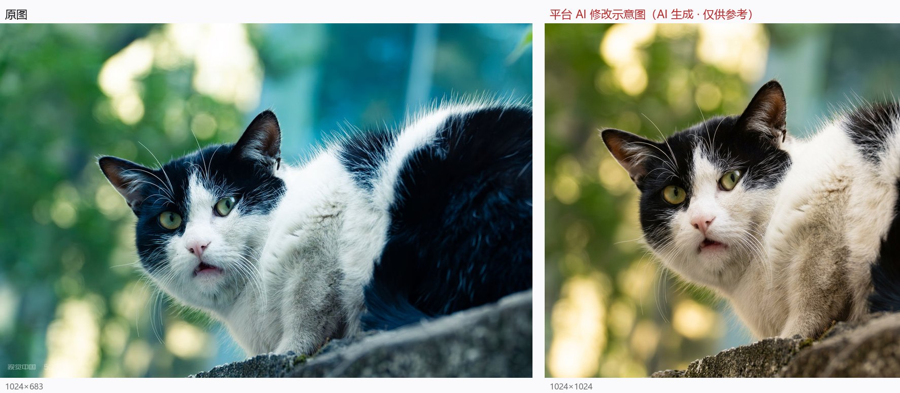

# 07 《猫的微讶》

> 平台评分：**6.7 / 10** · 档位 `REFINEMENT` · 5 个维度

**EXIF（实测）**：全部字段为 null（含 takenAt）

> 左：原图　右：平台生成的「AI 修改示意图」

## 平台原文

**总评**：你准确地抓住了这只黑白猫微张嘴巴、眼神直视镜头时的生动神态，侧逆光勾勒出的背部毛发轮廓光非常迷人。背景优美的圆形焦外斑点也为画面增添了层次感。目前主要的技术提升空间在于焦点略微落在了背部毛发而非眼睛上，同时白平衡偏冷偏青，让猫咪白色的毛发带上了冷调。我们只需微调焦距与白平衡，就能让这个精彩瞬间更加跃然纸上。

### 技术执行　6.5

画面整体曝光适中，侧逆光下的毛发高光保留得很好，背景的虚化光斑也很柔和。不过细看可以发现，焦点主要落在猫咪中背部耸起的高光毛发上，导致眼部与胡须的绝对锐度略显不足；同时画面整体色温偏冷、带明显青蓝色调。我们可以通过精准的眼部对焦与校正白平衡来完善细节。

- **建议**：拍摄配方建议：推荐设置光圈 f/2.8（维持美好虚化）、快门 1/500秒（凝固猫咪微小动作）、ISO 400（保证自然光下曝光充足）；对焦模式切换为「单点自动对焦」或开启「动物眼部追焦」，将对焦点严格锁定在靠近镜头的那只眼睛上；白平衡预设建议调至日光模式或手动设置色温约 5200K–5500K，还原毛发真实的暖白质感。

### 视觉美学　6.5

侧逆光带来的立体轮廓光非常赞，背景斑驳的光斑也构建了很漂亮的光影氛围。不过构图上猫咪头部过于靠近左侧边缘，且右侧猫身占据了较大面积的阴影块，视觉重心略显失衡。建议在右侧或上方预留更多呼吸空间，让猫咪视线的前方更舒展。

- **建议**：尝试采用85mm至135mm中长焦镜头，稍微向后退半步并稍微向右移动机位，将猫咪的眼睛放在画面左上方三分之一交叉点处，在猫咪看向的方向（左侧与正面）保留更多空间；调整视角让石墙斜线自然延伸至右下角，形成通往猫咪面部的情感引导线。

### 主体·场景·环境　7

户外自然的透光树荫为照片提供了上佳的光线基础，石墙与绿植也交代了很舒适的生态环境。主体与背景之间有良好的空间隔离感。如果光线能稍微再多一丝投射在猫咪的面部面庞上，环境与主体的互动会更加丰富。

- **建议**：保持现有的户外石墙与树荫环境，等待太阳移动到光线能穿过树叶缝隙、刚好有一缕柔和的漫射光点亮猫咪面部和眼睛的瞬间，或者使用反光板在暗侧补充一丝微弱的自然面部光彩。

### 叙事·氛围·情绪　7

抓拍的瞬间非常生动，「微讶」的眼神与稍微张开的小嘴充满了戏剧感与情绪张力，让人忍不住想知道它看到了什么。主体姿态自然，带有一种警觉而好奇的野生灵动感。这已经是一个极具吸引力的小故事瞬间。

- **建议**：在捕捉到这样精彩表情的瞬间，可以用轻微的声响（如发声玩具或轻轻扣击）吸引猫咪抬头仰视，使天空的光芒反射在它的瞳孔中形成晶莹的眼神光，从而极大增强情绪感染力。

### 艺术表达与原创　6.5

照片展示了创作者对动物决定性瞬间的敏锐观察力，将常见的小猫抓拍出了具有个人情绪色彩的微观叙事。若能结合更极致的光影构图与精准的技术表现，作品的艺术独特性会提升到一个新的高度。

- **建议**：在后续创作中，可以尝试将这种瞬间张力与更极简的影调控制相结合，比如强化背光明暗的对比，将背景进一步提炼为纯粹的光斑流动，创作出画意感更强的自然动物人像。

## 本案的问题

- **唯一一次诊断正确**：「白平衡偏冷偏青」；实测白毛区 B−R=+15.8，确实偏冷
- **但药方过冲**：自己的示意图把 +15.8 做到 −21.6（偏暖黄），背景从青蓝洗成暖绿
- 它夸「『微讶』的眼神……让人忍不住想知道它看到了什么」，转头建议「用发声玩具吸引猫抬头」——把悬念的成因安排好，等于处决悬念
- 从画面反推：墙下仰角 + 长焦；它却建议「85–135mm + 后退半步」（墙下无路可退）
