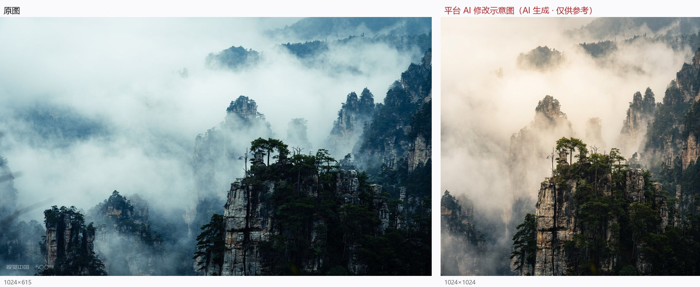

# 08 《千峰不过是云的留白》

> 平台评分：**7.1 / 10** · 档位 `REFINEMENT` · 5 个维度

**EXIF（实测）**：SONY ILCE-6400 · E PZ 18-105mm F4 G OSS · f/8 · 1/160s · ISO 100 · 55mm

> 左：原图　右：平台生成的「AI 修改示意图」

## 平台原文

**总评**：你敏锐地捕捉到了张家界独特砂岩峰林在云雾缭绕中的水墨意境。作品完美呈现了东方传统山水画中“留白”与“虚实相生”的美感，山脊上的松树形态优雅，与缥缈的云雾形成了动静对比。画面整体冷调的处理强化了高冷清幽的氛围，但在极左侧边缘有轻微的模糊遮挡干扰了视线，且右侧暗部细节略显压抑。如果我们能在构图边缘做更纯净的处理，并稍稍提亮山体暗部的岩石质感，整幅作品的水墨韵味将会更加通透苍翠。

### 技术执行　6.5

画面整体对焦精准，中景奇峰与松树的针叶细节清晰锐利，快门速度也成功凝固了云雾的流动感。美中不足的是左侧边缘出现了明显的镜头前物体遮挡（可能是近处杂草或枝条造成的虚影），同时偏蓝冷的色温使云雾显得略有硬度，缺乏自然光线的润泽感。

- **建议**：下次拍摄时请注意检查镜头周边环境，稍微向前站一步或微调角度避开左侧杂草遮挡；拍摄配方建议：曝光保持 f/8、1/160s、ISO 100（光线充足且需保证山体全锐），对焦模式建议采用单点 AF 锁在右前景主峰的松树岩石处，白平衡预设建议从冷调手动调整至日光模式（约 5200K–5500K）或微调 WB 色温偏移，保留云雾微润的暖白质感。

### 视觉美学　7

你将 55mm 端透视用得非常好，既保留了峰林的挺拔感，又巧妙地利用右侧近景山峰建立起极佳的视觉锚点。不过在右侧边缘，山脉的切割略显拥挤，右下角的阴影区域稍显偏沉，拉低了整体的视觉通透度。

- **建议**：尝试向左微调机位，使用大约 70mm 焦距将右侧主峰更舒展地置于三分线交点，为右侧边缘留出呼吸空间；同时略微抬高机位，让右下角的暗色山麓展现出更多雾气层叠的过渡。

### 主体·场景·环境　7.5

你捕捉到了绝佳的天气时机，雨后或晨雾中的峰林展现出了极强的气场与环境张力。山峰在雾气中若隐若现的动态非常迷人，完美传达了主体与环境的交融关系。

- **建议**：在现场耐心等待几分钟云雾漂移的动态缝隙，趁云雾微微散开、山峰底部若隐若现露出山脊线条的瞬间按动快门，能增强山势的挺拔感与纵深。

### 叙事·氛围·情绪　7.5

“千峰不过是云的留白”这一立意在画面中得到了很好的体现，幽深静谧的情绪氛围渲染得相当到位。画面有一种超然物外的古典诗意，让人愿意驻足细品。

- **建议**：可以尝试在早晨晨光初照、斜阳微微穿透云雾缝隙时拍摄，一缕暖光点亮山顶松树的瞬间会让画面的诗意从“孤冷”升华为“空灵与希望”。

### 艺术表达与原创　7

作品展现了鲜明的画意风光倾向，成功将传统中国水墨画的美学意境引入了摄影创作中，具有较好的艺术构思与视觉原创性。

- **建议**：在后期处理时，可尝试对山体暗部进行微量的暖灰升阶，保持高光云雾的纯净，用更微妙的中性灰色阶来演绎中国画的墨分五色。

## 本案的问题

- **「稍微向前站一步」避开左缘虚影——画面底边是云海深谷，向前一步即坠落**
- 左缘所谓「杂草遮挡」推测不成立：多方独立判读为云雾 / 山体前景 / 云气，无一认同「杂草」
- 「5200K–5500K 还原暖白」+「等晨光升华希望」——把水墨冷调当待修复的缺陷；示意图 B−R 从 +22.9 翻到 −24.9
- 「保持 f/8、1/160s、ISO 100」又是原参数复读
